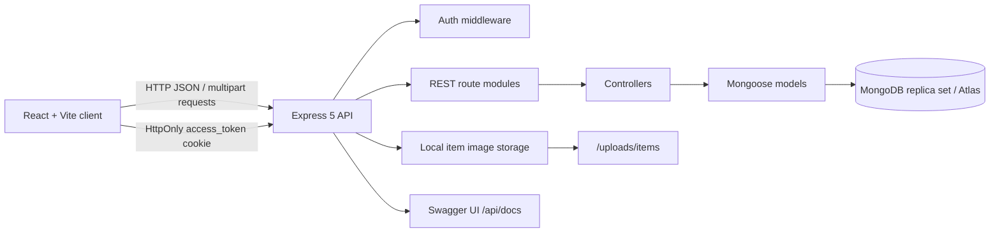

# Borrow My Stuff

[](#tech-stack)
[](#prerequisites)
[](./LICENSE)
[](#tech-stack)

Borrow My Stuff is a peer-to-peer campus marketplace for sharing useful items and requesting small campus tasks. Students can discover borrowable items, list their own belongings, request date-based bookings, and post or accept help gigs within an approved college-email community.

The project is designed around a practical problem: students often need an item temporarily, while other students already own underused equipment, books, instruments, sports gear, or everyday essentials. Borrow My Stuff connects those needs without pretending to be a full payment or social-messaging platform.

> **Current scope:** Item borrowing uses transactional booking workflows. Sale listings are informational and do not process payments. Uploaded item images use local server storage, which is suitable for local development but should be replaced with durable object storage for production deployments.

## Table of contents

- [Features](#features)
- [Tech stack](#tech-stack)
- [Architecture](#architecture)
- [Project structure](#project-structure)
- [Screenshots](#screenshots)
- [Prerequisites](#prerequisites)
- [Local installation](#local-installation)
- [Environment variables](#environment-variables)
- [Running the application](#running-the-application)
- [API reference](#api-reference)
- [Authentication](#authentication)
- [Database models](#database-models)
- [Booking workflow](#booking-workflow)
- [Security](#security)
- [Testing](#testing)
- [Deployment](#deployment)
- [Future enhancements](#future-enhancements)
- [Contributing](#contributing)
- [License](#license)

## Features

### Marketplace

- Browse available item listings.
- Search by title and description.
- Filter by category and item type.
- Sort by newest listings or price.
- Paginate item and gig results.
- View item details, owner information, availability, pricing, rules, and images.
- Create, edit, and delete owned listings.
- Upload up to six JPEG, PNG, or WebP images per item.
- Preview, remove, and replace images before submitting a listing.

### Borrowing

- Request an item for a specific start and end date.
- Reject invalid dates and past start dates.
- Prevent booking your own item.
- Allow multiple non-overlapping bookings for the same item.
- Reject overlapping pending, confirmed, or active bookings.
- Protect concurrent booking creation with a MongoDB transaction.
- Let borrowers cancel their own eligible bookings.
- Let owners confirm, activate, complete, or cancel bookings according to the state machine.
- Provide borrower and owner booking views in the dashboard.

### Campus help gigs

- Browse open gigs.
- Create gigs with category, budget, hostel, and urgency information.
- Accept an open gig atomically.
- Prevent the gig owner from accepting their own gig.
- Complete an accepted gig only when it is in progress.
- View the authenticated user’s gigs.

### Accounts and roles

- Register with an approved `@vitapstudent.ac.in` or `@vitap.ac.in` email address.
- Log in and log out with an HttpOnly access cookie.
- Revalidate the session through `/api/auth/me`.
- Persist user roles in MongoDB.
- Select supported roles: borrower, lender, seller, and helper.
- Protect authenticated routes and ownership-sensitive actions.

## Tech stack

| Layer | Technologies |
| --- | --- |
| Frontend | React 19, React Router, Vite, Tailwind CSS |
| Backend | Node.js, Express 5 |
| Database | MongoDB with Mongoose |
| Authentication | JSON Web Tokens, HttpOnly cookies, optional Bearer compatibility |
| Uploads | Multer with local filesystem storage |
| API documentation | Swagger UI and OpenAPI 3 |
| Testing | Vitest, Supertest, MongoDB Memory Server replica set |
| Quality and CI | ESLint, Vite production build, GitHub Actions |

## Architecture



The frontend communicates with the backend through the shared request helpers in `client/src/api`. The server exposes REST endpoints under `/api`, serves local item images at `/uploads/items`, and provides health information at `/health`.

## Project structure

```text
borrow my stuff/
├── client/
│   ├── public/                 # Favicon, icons, and local frontend assets
│   ├── src/
│   │   ├── api/                # API origin, HTTP helper, auth/items/bookings/gigs clients
│   │   ├── components/         # Navigation, branding, page states, error boundary
│   │   ├── context/            # Authentication context and hooks
│   │   ├── pages/              # Login, home, listings, item, dashboard, roles, gigs
│   │   ├── App.jsx             # Client routes and protected-route wrapper
│   │   └── main.jsx            # React entry point and error boundary
│   ├── package.json
│   └── vite.config.js
├── server/
│   ├── config/                 # Environment and database configuration
│   ├── controllers/            # Auth, item, booking, and gig business logic
│   ├── docs/                   # OpenAPI document
│   ├── middleware/             # Auth, CSRF, uploads, validation, and errors
│   ├── models/                 # User, Item, Booking, and Gig schemas
│   ├── routes/                 # Express route modules
│   ├── services/               # Booking state transitions
│   ├── tests/                  # Unit and integration tests
│   ├── uploads/items/          # Runtime local image storage
│   ├── .env.example
│   ├── index.js                # Express app factory and server startup
│   └── package.json
├── .github/workflows/ci.yml    # Server tests and client lint/build
├── LICENSE
└── README.md
```

## Screenshots

Add current screenshots to `docs/screenshots/` and replace the placeholders below:

| Page | Screenshot |
| --- | --- |
| Landing / login | `docs/screenshots/landing.png` |
| Marketplace listings | `docs/screenshots/listings.png` |
| Item details and booking | `docs/screenshots/item-details.png` |
| Dashboard and bookings | `docs/screenshots/dashboard.png` |

Example Markdown:

```md

```

## Prerequisites

- Node.js 20 or newer.
- npm.
- MongoDB running as a replica set, MongoDB Atlas, or another deployment that supports multi-document transactions.
- Git.

> Booking creation and booking status updates intentionally do not fall back to unsafe non-transactional writes. A deployment without transaction support returns `503 TRANSACTIONS_UNAVAILABLE`.

## Local installation

Clone the repository and install dependencies in both workspaces:

```powershell
git clone <repository-url>
cd "borrow my stuff"

cd server
npm install

cd ..\client
npm install
```

Create the server environment file:

```powershell
cd ..\server
Copy-Item .env.example .env
```

Update `server/.env` with a real local configuration. Never commit `.env`.

## Environment variables

The server validates `MONGO_URI`, `JWT_SECRET`, and `CLIENT_URL` before startup. The complete template is available at [`server/.env.example`](./server/.env.example).

| Variable | Required | Description | Example |
| --- | --- | --- | --- |
| `NODE_ENV` | No | Runtime environment | `development` |
| `PORT` | No | Express port | `5000` |
| `MONGO_URI` | Yes | MongoDB connection string | `mongodb://127.0.0.1:27017/borrowbox` |
| `JWT_SECRET` | Yes | JWT signing secret; minimum 32 characters | `replace-with-at-least-32-random-characters` |
| `CLIENT_URL` | Yes | Allowed frontend origin for CORS | `http://localhost:5173` |
| `COOKIE_SECURE` | No | Use Secure cookies; enable behind HTTPS | `false` |
| `UPLOAD_DIR` | No | Local item upload directory | `uploads/items` |
| `MAX_IMAGE_SIZE_MB` | No | Maximum size per image | `5` |
| `MAX_ITEM_IMAGES` | No | Maximum images per item | `6` |

The client uses `VITE_API_URL` when provided and otherwise defaults to `http://localhost:5000`:

```env
VITE_API_URL=http://localhost:5000
```

## Running the application

Start the backend in one terminal:

```powershell
cd server
npm run dev
```

Start the frontend in a second terminal:

```powershell
cd client
npm run dev
```

Local URLs:

- Frontend: <http://localhost:5173>
- API root: <http://localhost:5000>
- API health: <http://localhost:5000/health>
- Swagger UI: <http://localhost:5000/api/docs>

For a production-style local client build:

```powershell
cd client
npm run build
npm run preview
```

## API reference

Swagger UI is available at `/api/docs`. The primary REST endpoints are listed below. Protected endpoints require authentication.

### Authentication

| Method | Endpoint | Auth | Purpose |
| --- | --- | --- | --- |
| `POST` | `/api/auth/register` | Public | Register an approved college user |
| `POST` | `/api/auth/login` | Public | Log in and set the access cookie |
| `GET` | `/api/auth/me` | Protected | Return the current user |
| `PUT` | `/api/auth/roles` | Protected | Persist the current user’s roles |
| `POST` | `/api/auth/logout` | Public | Clear the access cookie |

### Items

| Method | Endpoint | Auth | Purpose |
| --- | --- | --- | --- |
| `GET` | `/api/items` | Public | List available items with `page`, `limit`, `search`, `category`, `type`, `sort`, and `all` filters |
| `GET` | `/api/items/:id` | Public | Get item details |
| `GET` | `/api/items/mine` | Protected | List the current user’s items |
| `POST` | `/api/items` | Protected | Create an item; accepts multipart image uploads |
| `PUT` | `/api/items/:id` | Protected | Update an owned item |
| `DELETE` | `/api/items/:id` | Protected | Delete an owned item |

### Bookings

| Method | Endpoint | Auth | Purpose |
| --- | --- | --- | --- |
| `POST` | `/api/bookings` | Protected | Create a date-based booking transaction |
| `GET` | `/api/bookings/mine` | Protected | List bookings made by the current borrower |
| `GET` | `/api/bookings/incoming` | Protected | List bookings for the current owner’s items; supports `status` |
| `PUT` | `/api/bookings/:id` | Protected | Perform an authorized state transition |

### Gigs

| Method | Endpoint | Auth | Purpose |
| --- | --- | --- | --- |
| `GET` | `/api/gigs` | Public | List gigs with pagination |
| `GET` | `/api/gigs/mine` | Protected | List the current user’s gigs |
| `POST` | `/api/gigs` | Protected | Create a gig |
| `PUT` | `/api/gigs/:id/accept` | Protected | Atomically accept an open gig |
| `PUT` | `/api/gigs/:id/complete` | Protected | Complete an in-progress gig |

Most server errors use the structure below:

```json
{
  "success": false,
  "code": "ERROR_CODE",
  "message": "Human-readable message"
}
```

## Authentication

Browser authentication uses an `access_token` HttpOnly cookie. The client sends credentials with API requests and revalidates the session on application load. The backend also accepts a `Bearer` token for compatibility with non-browser API clients.

Cookie-authenticated state-changing requests require the CSRF token issued by the server in the `borrowbox_csrf` cookie and sent in the `X-CSRF-Token` header. Login and registration are the only API authentication mutations exempt from this CSRF check.

## Database models

### User

Stores name, unique email, hashed password, hostel, persisted roles, and total earnings.

### Item

Stores title, description, category, type (`borrow` or `sell`), price, pricing unit, owner, hostel, availability, rules, and uploaded image metadata.

### Booking

Stores item, borrower, owner, start date, end date, calculated total price, status, and timestamps. Indexes support owner/status and borrower queries.

### Gig

Stores title, description, category, budget, poster, optional accepted user, hostel, urgency, status, and timestamps.

## Booking workflow

Booking creation runs inside a Mongoose session transaction:

1. Validate the item ID and requested dates.
2. Reject past start dates, invalid ranges, and owner self-booking.
3. Serialize access to the item.
4. Check for an overlapping `pending`, `confirmed`, or `active` booking.
5. Create the booking and calculate the total price.
6. Commit both operations together.

Non-overlapping bookings for the same item are allowed. Date ranges overlap when:

```text
existing.startDate < requested.endDate
AND existing.endDate > requested.startDate
```

Booking statuses follow this state machine:

```text
pending   -> confirmed -> active -> completed
pending   -> cancelled
confirmed -> cancelled
```

Borrowers may cancel their own eligible booking. Owners manage incoming booking requests for their items. Invalid transitions and unauthorized ownership actions are rejected.

## Security

- Passwords are hashed with `bcryptjs`; passwords and tokens are not logged.
- JWTs are stored in HttpOnly cookies for browser authentication.
- Secure and SameSite cookie options are configurable.
- CSRF protection covers authenticated cookie mutations.
- Helmet adds HTTP security headers.
- CORS is restricted to the configured `CLIENT_URL` and credentials are enabled.
- Login and registration use a strict rate limiter; API traffic also has a broader limiter.
- `trust proxy` is configured for deployments behind a reverse proxy.
- Uploads use bounded file counts, size limits, MIME checks, generated filenames, and a dedicated static route.
- Ownership checks protect item, booking, and gig management.
- Environment secrets are required at startup and are not stored in the repository.
- MongoDB transaction support is required for booking consistency.

## Testing

Run backend tests:

```powershell
cd server
npm test
```

The backend tests cover:

- Registration and login.
- College-domain restrictions.
- CSRF rejection.
- Concurrent booking attempts.
- Non-overlapping and overlapping booking dates.
- Concurrent gig acceptance.
- Ownership restrictions.
- Booking state-transition validation.
- Numeric validation.

Run client checks:

```powershell
cd client
npm run lint
npm run build
```

GitHub Actions runs the server test suite and client lint/build checks on pushes and pull requests through [`.github/workflows/ci.yml`](./.github/workflows/ci.yml).

## Deployment

1. Provision MongoDB Atlas or another MongoDB deployment with replica-set or sharded transaction support.
2. Deploy the Express server from `server/`.
3. Set `NODE_ENV=production`, a strong 32-character-or-longer `JWT_SECRET`, the production `MONGO_URI`, the deployed frontend `CLIENT_URL`, and `COOKIE_SECURE=true` behind HTTPS.
4. Run `npm install` and `npm start` in `server/`.
5. Build the client with `npm run build` in `client/`.
6. Serve the generated `client/dist` directory through a static host or reverse proxy.
7. Configure the reverse proxy to forward API requests to the Express server.
8. Use persistent object storage for item images before running multiple or ephemeral server instances. The current local upload directory is not a durable production storage layer.
9. Verify `/health`, authentication, uploads, and a complete booking transaction after deployment.

No hosting provider is hardcoded in this repository; deployment commands must be adapted to the chosen platform.

## Future enhancements

These are not currently implemented:

- Payment gateway integration with server-side verification and webhooks.
- Persistent cloud image storage and image processing.
- User-to-user chat with message persistence and authorization.
- Post-transaction reviews and ratings.
- Automated booking reminders and notifications.
- Production observability, metrics, and audit logs.
- Dedicated frontend component tests and end-to-end browser tests.

## Contributing

1. Fork the repository and create a focused feature branch.
2. Preserve existing API contracts, authorization rules, and booking transaction behavior.
3. Do not commit `.env` files, secrets, generated uploads, or build output.
4. Add or update tests for behavior changes.
5. Run `npm test` in `server/`, then `npm run lint` and `npm run build` in `client/`.
6. Keep pull requests focused and describe security or data-model implications.

## License

This project is distributed under the MIT License. See [`LICENSE`](./LICENSE).
